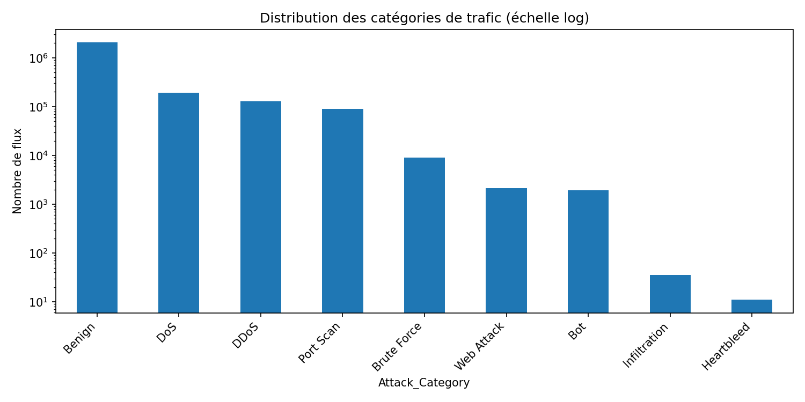
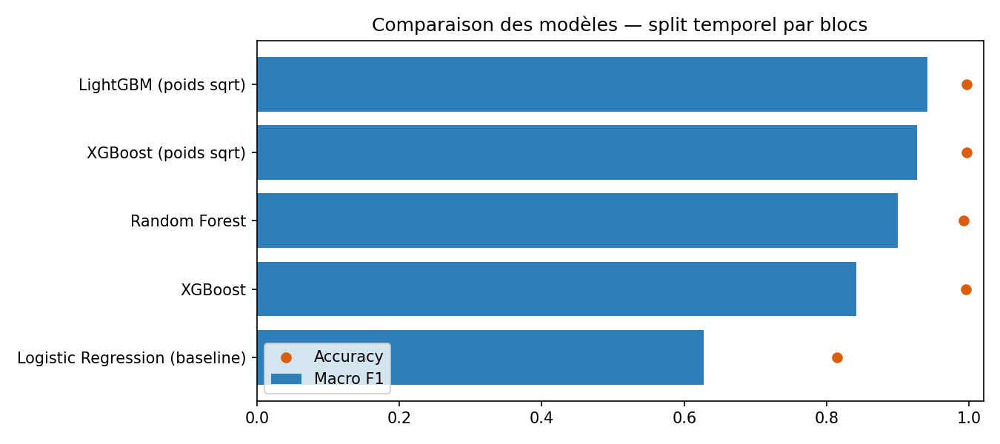
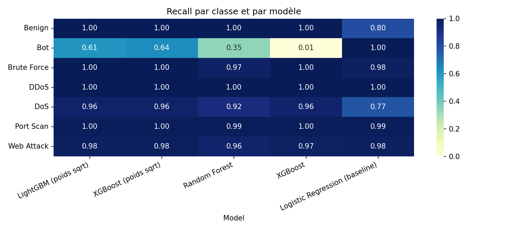
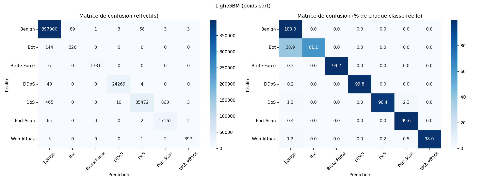
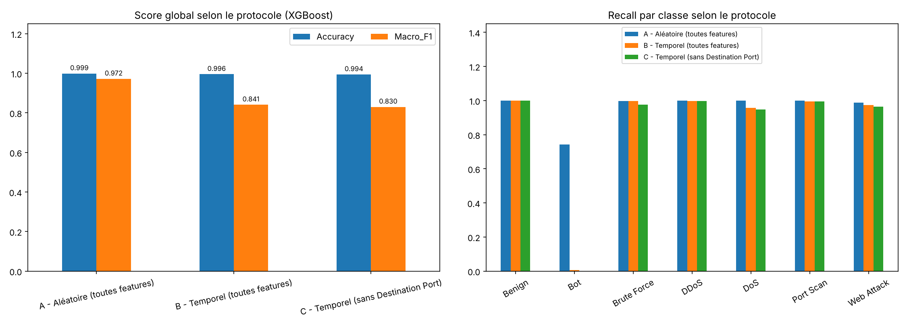
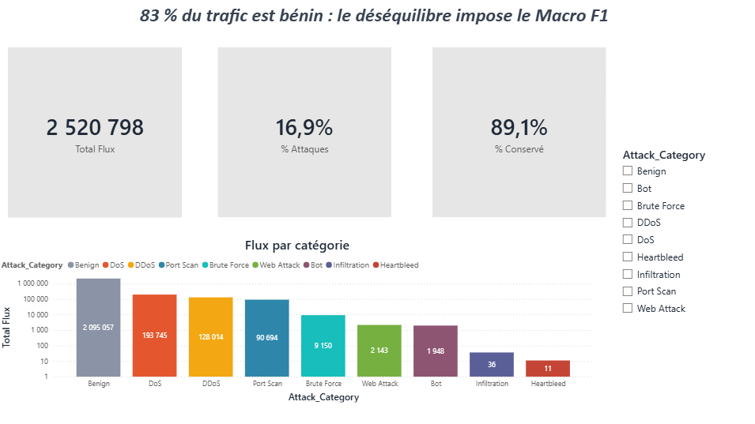
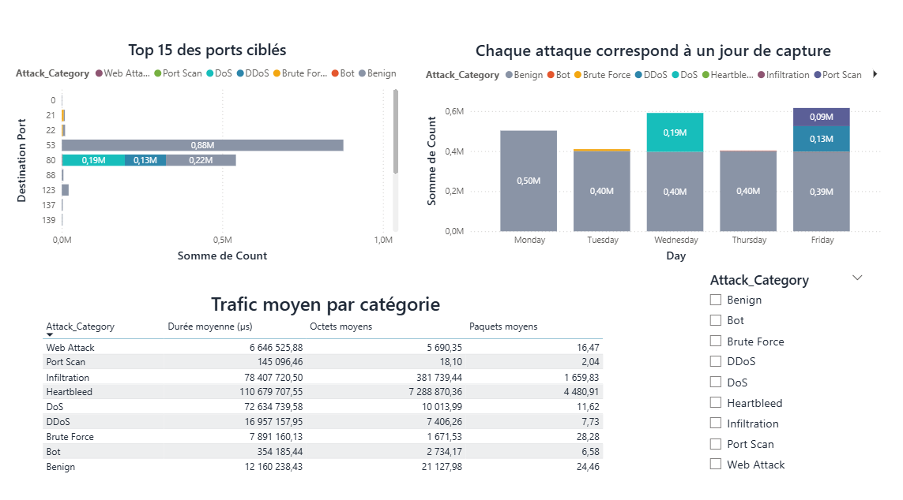

# Détection d'intrusions réseau — CICIDS2017

Projet de data analytics / machine learning en cybersécurité : détecter et classer le trafic réseau malveillant (DoS, DDoS, Port Scan, Brute Force, Web Attack, Bot) à partir du dataset **CICIDS2017**, avec un dashboard **Power BI**.

**Résultat principal :** sur un protocole d'évaluation temporel (sans fuite entre train et test), le meilleur modèle (LightGBM) atteint un **Macro F1 de 0,941**, détecte **99,1 %** des attaques avec seulement **0,04 %** de fausses alertes. Le point faible est la classe `Bot` (recall ≈ 61 %).

## Ce que ce projet montre
- Pipeline complet : fusion de 8 fichiers (2,83 M de flux bruts) → nettoyage → ML → export pour BI
- Évaluation rigoureuse sur données déséquilibrées (Benign = 83 %) : Macro F1 et recall par classe plutôt que l'Accuracy
- **Remise en cause de ses propres scores** : un split aléatoire donne un Macro F1 de 0,97, le split temporel seulement 0,84 pour le même modèle (voir « Robustesse »)

## Structure du projet
```text
├── data/
│   ├── raw/          # 8 CSV CICIDS2017 
│   └── processed/    # dataset nettoyé (généré, non versionné)
├── notebooks/
│   ├── 01_load_merge_clean.ipynb           # fusion, nettoyage, exports Power BI
│   ├── 02_machine_learning.ipynb           # 5 modèles, évaluation, sauvegarde
│   ├── 02b_leakage_robustness_check.ipynb  # test de leakage et de raccourcis
│   └── 03_inference_demo.ipynb             # utilisation du modèle sauvegardé
├── models/           # xgb_model.json + meta.json
├── results/          # CSV exportés (sources Power BI)
├── images/           # graphiques
├── POWERBI_GUIDE.md
└── requirements.txt
```

## Données
**CICIDS2017** (Canadian Institute for Cybersecurity, UNB), version « MachineLearningCVE » : 8 CSV, un par période de capture (lundi à vendredi). À placer dans `data/raw/`. Cette version ne contient ni IP, ni Flow ID, ni timestamp.

| Étape de nettoyage | Lignes |
|---|---|
| Flux bruts | 2 830 743 |
| Valeurs infinies / NaN | 4 376 / 1 358 |
| Doublons détectés | 308 381 (10,9 %) |
| **Flux finaux** | **2 520 798 (89,05 %)** |

Répartition finale : Benign 83,1 % · DoS 7,7 % · DDoS 5,1 % · Port Scan 3,6 % · Brute Force 0,36 % · Web Attack 0,09 % · Bot 0,08 % · Infiltration (36) et Heartbleed (11) exclues du ML.



## Lancer le projet
```bash
pip install -r requirements.txt
# exécuter dans l'ordre : 01 → 02 → 02b → 03
```
Durée indicative : ~1 h (Random Forest : ~14 min). `FAST_MODE = True` (début des notebooks 02/02b) permet un test rapide.

## Méthodologie
- **Métrique principale : Macro F1** (chaque classe pèse pareil) + recall par classe + MCC. L'Accuracy est donnée pour mémoire : elle dépasse 99 % même quand `Bot` est presque totalement raté.
- **Split temporel par blocs** : pour chaque couple *(fichier, label)*, 80 % premiers flux → train, 1 % tampon ignoré, ~19 % derniers → test (2 016 609 flux train / 478 932 test).
- **Déséquilibre** : poids de classes « racine » (XGBoost, LightGBM) ; le poids `balanced` complet détruisait la précision des classes rares dans la première version.
- **Hyperparamètres** : issus d'un `RandomizedSearchCV` (10 itérations, 3-fold) de la première version.

## Résultats (split temporel, 478 932 flux de test)

| Modèle | Accuracy | **Macro F1** | MCC | Entraînement | Inférence (ms / 1000 flux) |
|---|---|---|---|---|---|
| **LightGBM (poids sqrt)** | 0,9963 | **0,9414** | 0,9876 | 3 min | 22,6 |
| XGBoost (poids sqrt) | 0,9963 | 0,9264 | 0,9876 | 3 min | 5,5 |
| Random Forest | 0,9928 | 0,9000 | 0,9758 | 14 min | 10,5 |
| XGBoost (sans poids) | 0,9955 | 0,8413 | 0,9850 | 3 min | 5,0 |
| Logistic Regression (baseline) | 0,8147 | 0,6269 | 0,6255 | 3 min | 0,7 |



**Recall par classe** : toutes les attaques sont détectées à plus de 96 % **sauf `Bot` (≈ 61–64 %)**. Les poids de classes font passer le recall de `Bot` de 0,5 % (XGBoost sans poids) à 63,5 %.



**Matrice de confusion (LightGBM)** : les principales erreurs sont `DoS → Port Scan` (860 flux), `DoS → Benign` (465) et `Bot → Benign` (144 sur 370).



### Détection binaire (Attack vs Benign) — LightGBM
| Taux de détection | Précision | Taux de fausses alertes | Attaques ratées | Fausses alertes |
|---|---|---|---|---|
| **99,09 %** | 99,80 % | **0,039 %** | 734 / 80 875 | 157 / 398 057 |

### Modèle sauvegardé
`models/xgb_model.json` contient **XGBoost (poids sqrt)** : Macro F1 de 0,926 (contre 0,941) mais ~4× plus rapide en inférence et beaucoup plus léger. Voir `03_inference_demo.ipynb` pour l'utiliser.

## Robustesse : leakage et raccourcis (Notebook 02b)
Même modèle (XGBoost sans poids), trois protocoles :

| Scénario | Accuracy | Macro F1 | Recall `Bot` |
|---|---|---|---|
| A — Split aléatoire | 0,9992 | **0,9722** | 0,743 |
| B — Split temporel | 0,9955 | **0,8413** | 0,005 |
| C — Temporel, sans `Destination Port` | 0,9944 | 0,8303 | 0,000 |



- **A → B : −13 points de Macro F1.** Le split aléatoire gonfle fortement les scores, surtout sur `Bot` : des flux quasi identiques d'une même campagne se retrouvent dans le train et le test. L'Accuracy, elle, ne bouge presque pas (−0,4 pt) — c'est pourquoi elle est trompeuse ici.
- **B → C : −1 point.** `Destination Port` est la feature la plus utilisée, mais la retirer coûte peu : le modèle ne repose pas sur ce seul raccourci (impact surtout sur `Brute Force` : recall 99,8 % → 97,6 %).
- Les premiers résultats du projet (≈ 99,9 % d'Accuracy) venaient d'un split aléatoire et étaient donc optimistes.

## Dashboard Power BI
Voir [`POWERBI_GUIDE.md`](POWERBI_GUIDE.md) (modèle de données, pages, mesures DAX).

Fichier : [`powerbi/dashboard_cicids2017.pbix`](powerbi/dashboard_cicids2017.pbix)




> Pages « Performance ML » et « Robustesse & features » en cours de finalisation.

## Limites
- L'ordre des flux est **approximativement** chronologique (pas de timestamp). Le résultat de `Bot` en split temporel est à interpréter avec cette réserve.
- `Bot` : seulement 370 flux de test ; recall instable d'un protocole à l'autre.
- Le choix du meilleur modèle (LightGBM vs XGBoost) s'est fait sur le jeu de test, sans jeu de validation séparé ; l'écart entre les deux est faible. Une seule exécution (pas d'intervalle de confiance).
- Hyperparamètres cherchés sur un split aléatoire (v1), non relancés avec le split temporel.
- La baseline Logistic Regression n'a pas totalement convergé (200 itérations).
- CICIDS2017 est un dataset de laboratoire (2017) avec des outils d'attaque automatisés : les scores ne se transposent pas tels quels à un réseau réel.
- `Infiltration` et `Heartbleed` non modélisées (trop rares).

## Pistes d'amélioration
- Dataset avec timestamps et IP (CIC-IDS2018, UNSW-NB15) pour un vrai split par session / par jour
- Traitement dédié de `Bot` (SMOTE, détection d'anomalies, seuil par classe)
- Jeu de validation séparé + plusieurs seeds pour des intervalles de confiance
- Calibration des probabilités et choix du seuil d'alerte selon le coût des fausses alertes

## Outils
Python · pandas · scikit-learn · XGBoost · LightGBM · Power BI
